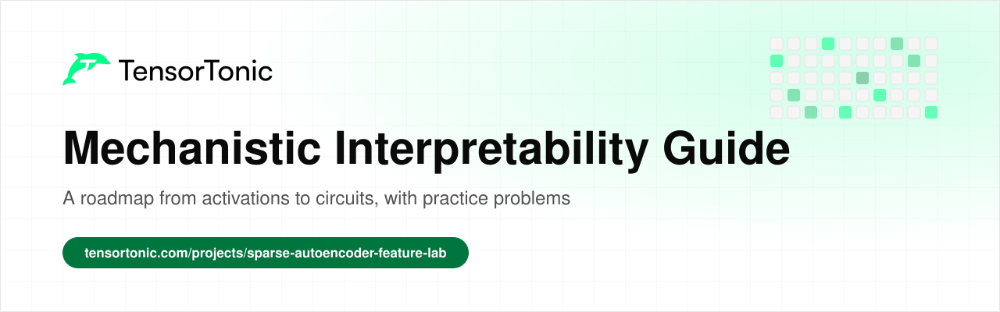
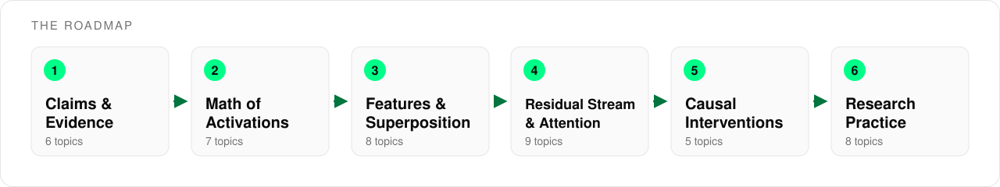

# Mechanistic Interpretability Guide

  

This is a roadmap for learning mechanistic interpretability, the study of what a trained neural network actually computes inside. It covers 43 topics across six stages, from how to state a claim about a model to features, attention circuits, causal interventions and honest reporting.

Every topic links to a short explanation and to practice problems where you implement the idea in Python and check your code against tests. Most interpretability methods are a few lines of linear algebra on top of a forward pass, and writing those pieces yourself makes it much easier to see what a method can and cannot tell you.

## Table of Contents

- [Who this is for](#who-this-is-for)
- [How to use this roadmap](#how-to-use-this-roadmap)
- [Stage 1: Claims and Evidence](#stage-1-claims-and-evidence)
- [Stage 2: The Math of Activations](#stage-2-the-math-of-activations)
- [Stage 3: Features and Superposition](#stage-3-features-and-superposition)
- [Stage 4: The Residual Stream and Attention](#stage-4-the-residual-stream-and-attention)
- [Stage 5: Causal Interventions](#stage-5-causal-interventions)
- [Stage 6: Research Practice](#stage-6-research-practice)
- [What's next](#whats-next)

## Who this is for

This roadmap is for anyone who wants to look inside a model and make claims about it that someone else could check.

- If you are an **ML engineer**, the residual stream, attention and intervention stages show you how to locate the parts of a model behind a behaviour you care about.
- If you are a **researcher** starting in interpretability, the first and last stages give you a standard for evidence that the rest of the field relies on.
- If you are a **student** who knows basic deep learning, go through the stages in order and do at least one problem per topic.

You need Python, NumPy and a working idea of what a neural network layer does. You do not need a GPU or a large pretrained model to learn the methods.

## How to use this roadmap

The stages follow the order an investigation usually takes. You first decide what would count as evidence, then learn the math for reading activations, then study what models represent and how information moves, and finally test those findings with interventions.

For each topic, read the explanation first, then solve one or two of the practice problems. Stages 3 and 4 can be taken in either order. Topics without a practice link are still worth reading because the later stages build on them.

## Stage 1: Claims and Evidence

An interpretability result is only as good as the evidence behind it. This stage separates statements about inputs and outputs from statements about internal mechanisms, and covers the probability and statistics you need to tell an observation apart from a causal finding.

| Topic | Read | Practice |
| --- | --- | --- |
| Behavioural vs mechanistic claims | | [Linear Layer Forward Pass](https://www.tensortonic.com/problems/linear-layer-forward), [Evaluate a Multi-Layer Perceptron](https://www.tensortonic.com/problems/autograd-l07-mlp-forward) |
| Neurons and activations | [Matrix multiplication for deep learning](https://www.tensortonic.com/ml-math/linear-algebra/matrix-multiplication) | [ReLU Activation in NumPy](https://www.tensortonic.com/problems/relu-activation) |
| Correlation is not causation | [Pearson vs Spearman correlation](https://www.tensortonic.com/ml-math/statistics/correlation) | [Compute Pearson Correlation Matrix](https://www.tensortonic.com/problems/pearson-correlation) |
| Conditional probability | [Conditional probability explained](https://www.tensortonic.com/ml-math/probability/conditional-probability) | [Conditional Probability](https://www.tensortonic.com/problems/probstat-conditional-probability) |
| Updating beliefs with evidence | [Bayes' theorem explained](https://www.tensortonic.com/ml-math/probability/bayes-theorem) | [Bayes' Theorem](https://www.tensortonic.com/problems/probstat-bayes-theorem) |
| Testing a hypothesis | [How hypothesis testing works](https://www.tensortonic.com/ml-math/statistics/hypothesis-testing) | [One-Sample t-Test](https://www.tensortonic.com/problems/t-test-one-sample) |

## Stage 2: The Math of Activations

Most interpretability tools assume that meaningful quantities are directions in activation space and that components interact through sums. This stage covers the linear algebra behind that assumption and the habit of reading and editing activations during a forward pass.

| Topic | Read | Practice |
| --- | --- | --- |
| Dot products and norms | [Dot product and vector norms](https://www.tensortonic.com/ml-math/linear-algebra/dot-norm) | [Dot Product](https://www.tensortonic.com/problems/dot-product), [Cosine Similarity](https://www.tensortonic.com/problems/cosine-similarity) |
| Projecting onto a direction | [Projections and least squares](https://www.tensortonic.com/ml-math/linear-algebra/projections-least-squares) | [Vector Projection](https://www.tensortonic.com/problems/la-vector-projection), [Orthogonal Projection Matrix](https://www.tensortonic.com/problems/la-orthogonal-projection) |
| Near-orthogonal directions | [Orthogonality and the Gram-Schmidt process](https://www.tensortonic.com/ml-math/linear-algebra/orthogonality) | [Gram-Schmidt Orthogonalization](https://www.tensortonic.com/problems/la-gram-schmidt) |
| Bilinear forms in attention scores | [Attention in LLMs](https://www.tensortonic.com/llm-internals/attention-mechanism) | [Named-Dimension Batched Attention Scores](https://www.tensortonic.com/problems/cs336-l02-einsum-attention-scores) |
| Softmax and logits | [Cross-entropy loss](https://www.tensortonic.com/ml-math/information-theory/cross-entropy) | [Numerically Stable Softmax](https://www.tensortonic.com/problems/softmax-function) |
| Reading and editing activations with hooks | [Build a Sparse Autoencoder Feature Lab](https://www.tensortonic.com/projects/sparse-autoencoder-feature-lab) | |
| Distributed computation across neurons | [Autograd from scratch](https://www.tensortonic.com/study-plans/autograd-from-scratch) | [Train a Tiny Micrograd MLP](https://www.tensortonic.com/problems/autograd-l08-train-tiny-micrograd-mlp) |

## Stage 3: Features and Superposition

Individual neurons often respond to several unrelated things, because a network can store more features than it has dimensions. This stage explains why that happens and how sparse autoencoders try to recover the underlying features as a dictionary of directions.

| Topic | Read | Practice |
| --- | --- | --- |
| Features, polysemanticity and superposition | [Build a Sparse Autoencoder Feature Lab](https://www.tensortonic.com/projects/sparse-autoencoder-feature-lab) | |
| Principal components | [PCA explained](https://www.tensortonic.com/ml-math/linear-algebra/pca) | [PCA Projection onto Principal Components](https://www.tensortonic.com/problems/pca-projection), [PCA from Scratch](https://www.tensortonic.com/problems/la-pca-from-scratch) |
| Low-rank structure | [SVD explained](https://www.tensortonic.com/ml-math/linear-algebra/svd) | [Low-Rank Approximation](https://www.tensortonic.com/problems/la-low-rank-approx) |
| Sparse autoencoders | [Mechanistic Interpretability projects](https://www.tensortonic.com/projects/sheets/mechanistic-interpretability) | [Autoencoder Forward Pass](https://www.tensortonic.com/problems/dl-autoencoder) |
| The L1 sparsity penalty | [Dot product and vector norms](https://www.tensortonic.com/ml-math/linear-algebra/dot-norm) | [Lasso Regression using ISTA](https://www.tensortonic.com/problems/optim-lasso-ista) |
| Training the dictionary | [Which optimizer to use in deep learning](https://www.tensortonic.com/guides/which-optimizer-to-use) | [Adam Optimizer Step](https://www.tensortonic.com/problems/adam-optimizer) |
| Scoring a feature explanation | [Machine learning evaluation metrics](https://www.tensortonic.com/guides/ml-evaluation-metrics) | [Compute Accuracy, Precision, Recall, F1](https://www.tensortonic.com/problems/classification-metrics) |
| Distributed word representations | [Word2vec skip-gram loss](https://www.tensortonic.com/research/word2vec/word2vec-sgns-loss) | |

## Stage 4: The Residual Stream and Attention

A transformer is easier to read as a shared stream that every attention head and MLP reads from and adds to. This stage covers that view, the split of an attention head into where it looks and what it moves, and how heads in different layers compose.

| Topic | Read | Practice |
| --- | --- | --- |
| Token embeddings | [Transformer embeddings](https://www.tensortonic.com/research/transformer/transformers-embedding) | |
| Positional information | [Positional encoding](https://www.tensortonic.com/research/transformer/transformers-positional-encoding) | [RoPE: Rotary Query and Key Embeddings](https://www.tensortonic.com/problems/cs336-l03-rotary-query-key-embeddings) |
| The residual stream | [Transformer encoder block](https://www.tensortonic.com/research/transformer/transformers-encoder-block) | [Residual Block](https://www.tensortonic.com/problems/pytorch-residual-block) |
| Layer normalization | [Layer normalization](https://www.tensortonic.com/research/transformer/transformers-layer-normalization) | [RMSNorm Forward Pass](https://www.tensortonic.com/problems/cs336-l03-rmsnorm-forward) |
| The QK circuit and attention patterns | [Attention](https://www.tensortonic.com/research/transformer/transformers-attention) | [Causal Masking for Attention](https://www.tensortonic.com/problems/causal-masking) |
| The OV circuit and multiple heads | [Multi-head attention](https://www.tensortonic.com/research/transformer/transformers-multi-head-attention) | [Causal Grouped-Query Attention](https://www.tensortonic.com/problems/cs336-l03-causal-grouped-query-attention) |
| MLP blocks | [Feed-forward layer](https://www.tensortonic.com/research/transformer/transformers-feed-forward) | [Parameter-Matched SwiGLU Block](https://www.tensortonic.com/problems/cs336-l03-parameter-matched-swiglu) |
| Direct logit attribution | [GPT pretraining and next-token prediction](https://www.tensortonic.com/llm-internals/gpt-pretraining) | |
| Induction heads and composition | [Attention in LLMs](https://www.tensortonic.com/llm-internals/attention-mechanism) | |

## Stage 5: Causal Interventions

Observing activations shows what a model represents, and intervening on them shows what it uses. This stage covers ablation and activation patching, the metrics used to measure their effect, and how to test a circuit hypothesis on inputs designed to break it.

| Topic | Read | Practice |
| --- | --- | --- |
| Ablation | [Build a Sparse Autoencoder Feature Lab](https://www.tensortonic.com/projects/sparse-autoencoder-feature-lab) | [Permutation Feature Importance](https://www.tensortonic.com/problems/ml-perm-importance), [Dropout (Training Mode)](https://www.tensortonic.com/problems/dropout-training) |
| Activation patching | [Mechanistic Interpretability projects](https://www.tensortonic.com/projects/sheets/mechanistic-interpretability) | |
| Logit and loss metrics | [Perplexity in LLMs](https://www.tensortonic.com/ml-math/information-theory/perplexity) | [Cross-Entropy Loss](https://www.tensortonic.com/problems/cross-entropy-loss), [Compute Conditional Perplexity](https://www.tensortonic.com/problems/cs336-l12-conditional-perplexity) |
| Comparing output distributions | [KL divergence](https://www.tensortonic.com/ml-math/information-theory/kl-divergence) | [KL Divergence](https://www.tensortonic.com/problems/kl-divergence) |
| Stress-testing a circuit hypothesis | | [Data Drift Detection](https://www.tensortonic.com/problems/data-drift-detection) |

## Stage 6: Research Practice

Interpretability results are easy to over-read because they often come as pictures and stories. This stage covers the controls, sampling habits and statistics that keep a finding scoped to what was actually tested.

| Topic | Read | Practice |
| --- | --- | --- |
| Controls and random seeds | [Resampling methods](https://www.tensortonic.com/ml-math/statistics/resampling) | [Sample Variance & Standard Deviation](https://www.tensortonic.com/problems/sample-var-std), [Bootstrap Mean & Confidence Interval](https://www.tensortonic.com/problems/bootstrap-mean) |
| Reporting uncertainty | [Confidence intervals](https://www.tensortonic.com/ml-math/statistics/confidence-interval) | |
| Held-out and representative examples | | [K-Fold Split](https://www.tensortonic.com/problems/kfold-split), [Stratified Train/Test Split](https://www.tensortonic.com/problems/stratified-split) |
| Explanations as classifiers | [Integration and AUC-ROC](https://www.tensortonic.com/ml-math/calculus/integration-auc) | [Compute ROC Curve from Scores](https://www.tensortonic.com/problems/roc-curve), [Compute AUC (Area Under ROC)](https://www.tensortonic.com/problems/auc) |
| Calibration of explanation scores | | [Expected Calibration Error](https://www.tensortonic.com/problems/expected-calibration-error) |
| Agreement between human labellers | | [Cohen's Kappa](https://www.tensortonic.com/problems/cohens-kappa) |
| Significance and p-values | [P-value explained](https://www.tensortonic.com/ml-math/statistics/p-value) | [Chi-Square Test](https://www.tensortonic.com/problems/chi2-independence) |
| Reading and replicating papers | [How to read an ML paper and implement it](https://www.tensortonic.com/guides/how-to-read-and-implement-ml-papers) | |

## What's next

Once these methods feel familiar, the next step is to apply them to a real model. The [Sparse Autoencoder Feature Lab](https://www.tensortonic.com/projects/sparse-autoencoder-feature-lab) has you train a sparse autoencoder on a model's activations and test whether the model relies on a feature, and the [Language Modeling from Scratch](https://www.tensortonic.com/study-plans/language-modeling-from-scratch) study plan builds the transformer pieces you will spend your time taking apart.

## License

MIT
